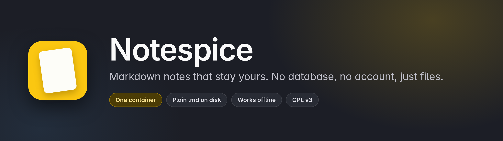
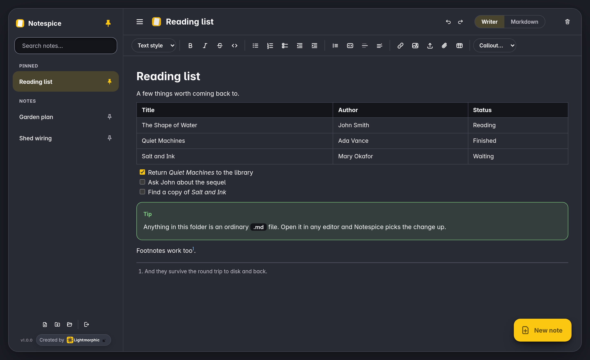
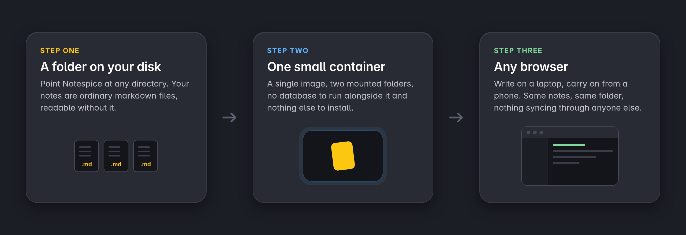
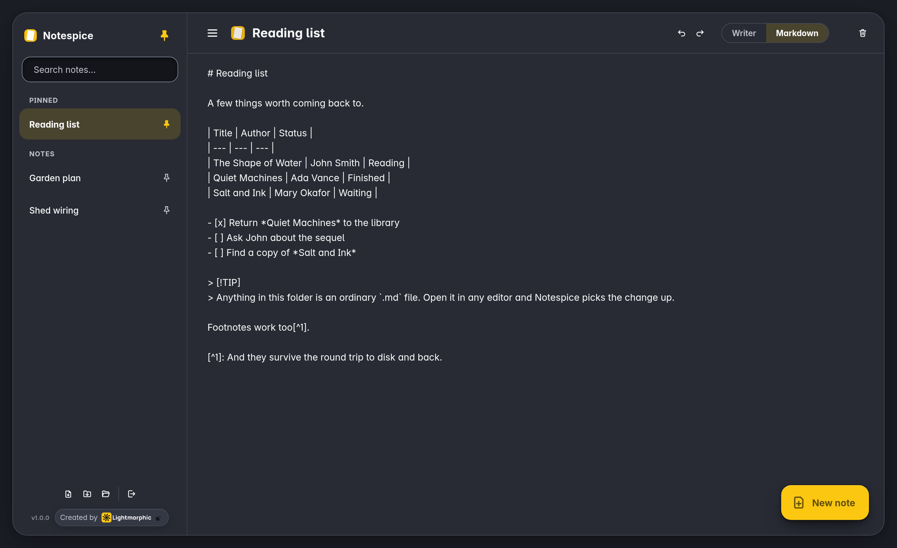
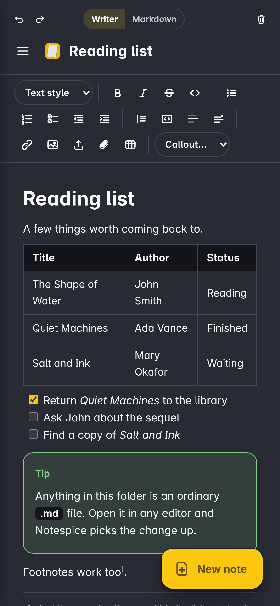

<p align="center">
  
</p>

<p align="center">
  
  
  
  
</p>

Notespice is a self-hosted notes app with no database. Every note is a
plain markdown file in a folder you choose, so you can read, edit, move
or back up your notes with any other tool, and walk away from this app
whenever you like without leaving anything behind.

It is one small container, a Rust backend, and a frontend with no build
step and nothing loaded from a CDN.

<p align="center">
  
</p>

## How it works

<p align="center">
  
</p>

## Quick start

```yaml
services:
  notespice:
    image: ghcr.io/gh-lm/notespice:latest
    container_name: notespice
    restart: unless-stopped
    environment:
      NOTES_USERNAME: "admin"
      NOTES_PASSWORD: "changeMe!"
    volumes:
      - /opt/media/notes:/notes
      - /opt/notespice:/data
    ports:
      - "8080:8080"
```

```bash
sudo mkdir -p /opt/media/notes /opt/notespice
sudo chown -R 1000:1000 /opt/media/notes /opt/notespice
docker compose up -d
```

Open <http://localhost:8080>.

The container runs as a non-root user (UID and GID 1000), not root, so
the `chown` above matters: without it Notespice cannot write to the
mounted folder and will fail to create or update notes. Run it when you
first create the directories, and again if you are moving an existing
install across.

Notes (`*.md`) and attachments (`files/`) end up under
`/opt/media/notes`, and that is the one directory worth backing up.
`/opt/notespice` holds app-only state, currently just the
recently-viewed and pinned lists. It is safe to lose, and kept separate
on purpose so it never mixes in with your actual notes.

Put this behind a TLS-terminating reverse proxy (nginx, Caddy, Traefik
or Tailscale Serve) for anything beyond local testing. The `Secure`
cookie flag is on by default and needs the browser to have reached the
app over HTTPS, and so does installing it as a PWA.

To update:

```bash
docker compose pull
docker compose down
docker compose up -d
```

`docker compose up -d` on its own will not re-pull a cached `:latest`.

### Without Docker

You need a reasonably current stable Rust toolchain. Install one from
[rustup](https://rustup.rs) if your package manager's version is old.

```bash
git clone https://github.com/gh-lm/notespice.git
cd notespice
cargo build --release
NOTES_PASSWORD=changeMe123 NOTES_DIR=./notes NOTES_DATA_DIR=./appdata ./target/release/notespice
```

Service workers need HTTPS, with `localhost` exempt for testing, so
offline support and "Add to home screen" only work once this is served
over TLS on a real domain.

## Writing in it

The editor shows your note laid out, and one click shows the markdown
underneath it. Both are the same file: nothing is translated into a
private format on the way to disk.

<table>
<tr>
<td width="50%"></td>
<td width="50%" align="center"></td>
</tr>
<tr>
<td align="center"><b>The markdown behind the note</b></td>
<td align="center"><b>The same notes on a phone</b></td>
</tr>
</table>

The converter is small and hand-written for this app. There is no
third-party editor library and nothing fetched from a CDN, so there is
nothing to version-mismatch or quietly break.

## What it does

- A markdown toolbar covering the parts of GitHub Flavored Markdown
  most people use: headings, bold, italic, strikethrough, inline code,
  bullet, numbered and checkbox lists with indent and outdent,
  blockquotes, fenced code blocks, horizontal rules, tables, links,
  images, attachments, footnotes, and GitHub-style callouts
- No database. Every note is a `.md` file you can open, edit or move
  with any other tool, even while the app is running
- Images, uploads and file attachments, stored beside your notes and
  referenced by ordinary markdown links
- Full-text search, plus instant filtering by name as you type
- Pinned notes first, then your last ten viewed notes, then everything
  else by modified date
- Undo and redo
- Export one note as markdown or PDF, or everything as one dated zip,
  and import that same zip back in without ever overwriting
- Installable as a PWA, with the app shell working offline
- Dark throughout, with no theme setting to fiddle with
- Argon2id password hashing, per-IP login rate limiting, and the other
  choices listed under [Security](#security)
- Self-hosted Trindle Sans under the SIL Open Font Licence, so no font
  CDN and no external font request of any kind

## Settings

| Variable | Required | Default | What it does |
|---|---|---|---|
| `NOTES_USERNAME` | no | `admin` | Login username |
| `NOTES_PASSWORD` | **yes** | none | Login password, at least 8 characters. Hashed with Argon2id in memory at startup, never stored or logged in plaintext. |
| `NOTES_DIR` | no | `/notes` | Where `.md` files and their `files/` attachments live. This is the vault. |
| `NOTES_DATA_DIR` | no | `/data` | Where app-only state lives. Not notes. |
| `NOTES_PORT` | no | `8080` | Port to listen on |
| `NOTES_INSECURE_COOKIES` | no | `false` | Set to `true` **only** for local testing over plain `http://`. It removes the `Secure` flag from the session cookie, so never set it in production. |

## Where your notes live

Every note is `<NOTES_DIR>/<title>.md`, a plain UTF-8 markdown file. The
filename is the note title. Anything you insert into a note, whether an
image, a PDF or any other attachment, is uploaded to
`<NOTES_DIR>/files/<name>` and referenced by a relative link, so the
whole vault stays one bind-mounted directory.

There is no database and no hidden index that matters: the search index
lives in memory and rebuilds from these files every time the app starts.
You can add, edit or delete `.md` files, or drop files straight into
`files/`, while the app is stopped. You can do it while it is running
too, though you will need a restart to pick the change up, because the
index does not watch the filesystem.

`NOTES_DATA_DIR` holds two small JSON files: `.recent.json`, an array of
up to ten titles most-recent-first, and `.pinned.json`, an array of
pinned titles. Delete either and you lose nothing but the sidebar
ordering or the pins.

Note titles and attachment filenames both go through the same allow-list
sanitiser before touching the disk. Duplicate uploads get a `-2`, `-3`
suffix rather than overwriting. Fetching an attachment needs the same
session cookie as everything else, so nothing is reachable by a
logged-out visitor just because it is rendered as an `` tag.
Uploads are capped at 20MB per file.

## Export and import

The sidebar footer has four buttons: export this note, export
everything, import, and log out.

**Export this note** downloads the open note as **Markdown**, which is
its own file exactly as stored and built entirely in the browser, or as
**PDF**, which goes through the browser's own print-to-PDF rather than
a rendering library.

**Export all** downloads every note and attachment as one zip named
`YYYY-MM-DD_notes.zip`: notes at the root as `.md` files, attachments
under `files/`. An export is the same shape as an import, so it is also
a valid import.

**Import** takes that same zip, or a single loose `.md` file whose
filename becomes the note title. It never overwrites. A title that
already exists gets a `(1)`, `(2)` suffix instead, so re-importing an
export you already have adds a copy rather than silently replacing
anything.

## Security

Found a vulnerability? [SECURITY.md](./SECURITY.md) says how to report
it. What follows is about what is already built in.

- Passwords are hashed with Argon2id. Only the hash is ever held in
  memory, and it is never written to disk or logged.
- Sessions are opaque random tokens held server-side. The cookie itself
  carries no information, so nothing meaningful leaks if it is captured
  outside TLS.
- Login attempts are rate-limited per source IP, eight attempts per
  fifteen minutes, to blunt brute-force attempts.
- Every note title passes through an allow-list sanitiser before it
  touches the filesystem, closing off requests that try to climb out of
  the notes folder at the one place all note I/O goes through.
- The container runs as a non-root user and the base image's OS packages
  are patched at every build.
- Request bodies are capped at 25MB, covering the 20MB per-file
  attachment cap plus multipart overhead. Zip imports are additionally
  capped on decompressed size, 20MB per entry and 200MB per archive, so
  a crafted zip bomb cannot exhaust the server.

## Building it yourself

```bash
git clone https://github.com/gh-lm/notespice.git
cd notespice
docker build -t notespice .
```

The published image is built by
[the workflow in this repository](.github/workflows/release.yml) when a
version tag is pushed, and lands at `ghcr.io/gh-lm/notespice`.

### What is in the repository

```
notespice/
├── src/                      # Rust backend (axum)
│   ├── main.rs
│   ├── auth.rs               # password hashing, sessions, rate limiting
│   ├── handlers.rs           # HTTP route handlers
│   ├── store.rs              # note, attachment and recent-view file I/O
│   └── search.rs             # in-memory inverted-index search
├── static/                   # Frontend: plain HTML, CSS and JS, no build step
│   ├── index.html
│   ├── app.js
│   ├── style.css
│   ├── manifest.json         # PWA manifest
│   ├── sw.js                 # service worker, app shell only, no note data
│   ├── icons/
│   ├── fonts/                # self-hosted Trindle Sans (variable)
│   └── images/
├── site/                     # The notespice.org website
├── tests/
│   └── e2e-roundtrip.js      # 58-scenario Writer and Markdown suite
├── docs/images/              # The pictures in this README
├── .github/workflows/        # Builds and publishes the image
├── Cargo.toml
├── Dockerfile
├── docker-compose.yml
├── CHANGELOG.md
├── SECURITY.md
└── LICENSE
```

The Writer and Markdown converter is guarded by
`tests/e2e-roundtrip.js`: 58 scenarios covering the supported feature
set in both directions, plus real toolbar and keyboard interactions,
driven against the running app in a real browser. Anything touching the
editor, the converter or Enter and paste handling should keep that suite
at 58 out of 58 before it ships.

This app exists to be small enough to read top to bottom. No frontend
build step, no database, no dependency that is not earning its place.

## Licence

Copyright (C) 2026 Lightmorphic Ltd.

Notespice is free software: you can redistribute it and modify it under
the terms of the GNU General Public License version 3, as published by
the Free Software Foundation.

It is distributed in the hope that it will be useful, but WITHOUT ANY
WARRANTY, without even the implied warranty of MERCHANTABILITY or
FITNESS FOR A PARTICULAR PURPOSE. See [LICENSE](./LICENSE) for the full
text, or <https://www.gnu.org/licenses/>.

Releases up to and including 1.8.24 were published under the MIT
Licence. That grant cannot be withdrawn, so those versions stay
available on those terms. Everything from 1.8.25 on is GPL v3.

[CHANGELOG.md](./CHANGELOG.md) has the version history.

## Disclaimer

This software is provided "as is", without warranty of any kind, express
or implied. See the LICENSE file for the exact legal terms. You use it
entirely at your own risk.
